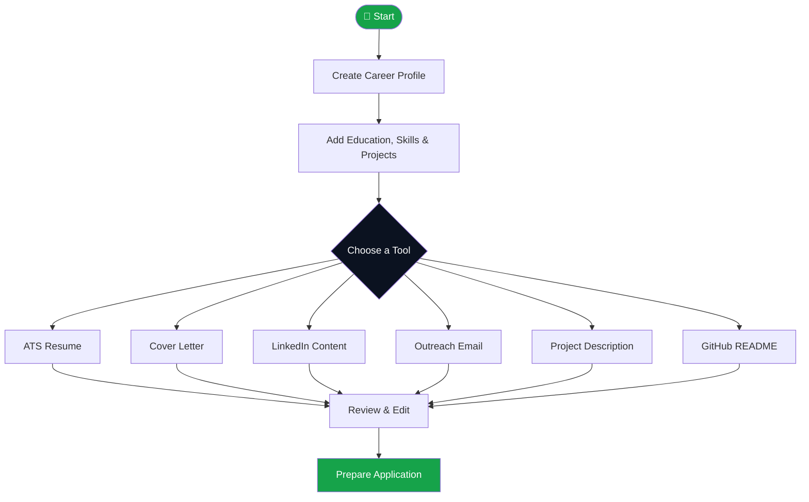
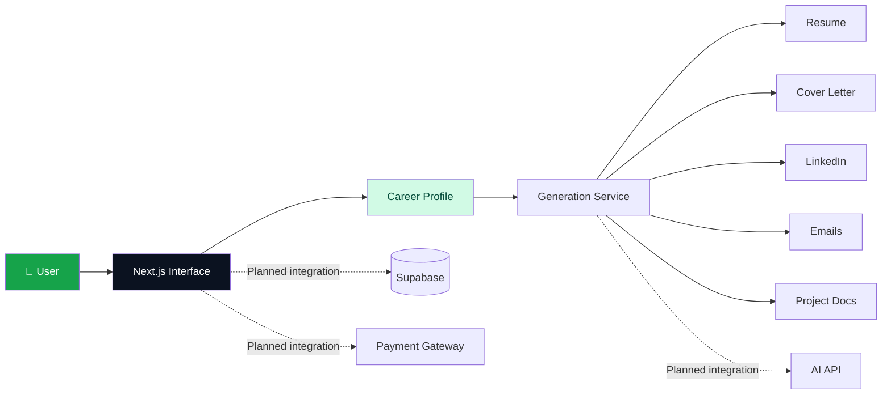
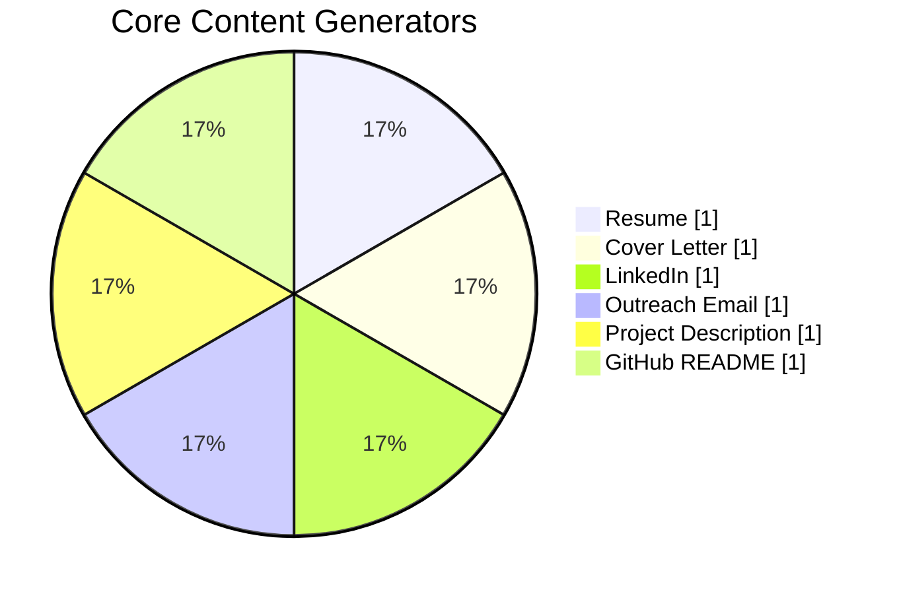
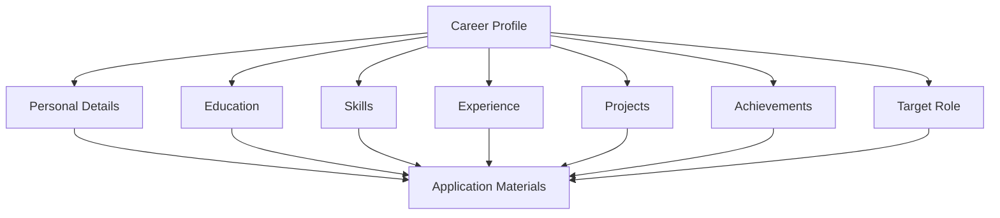
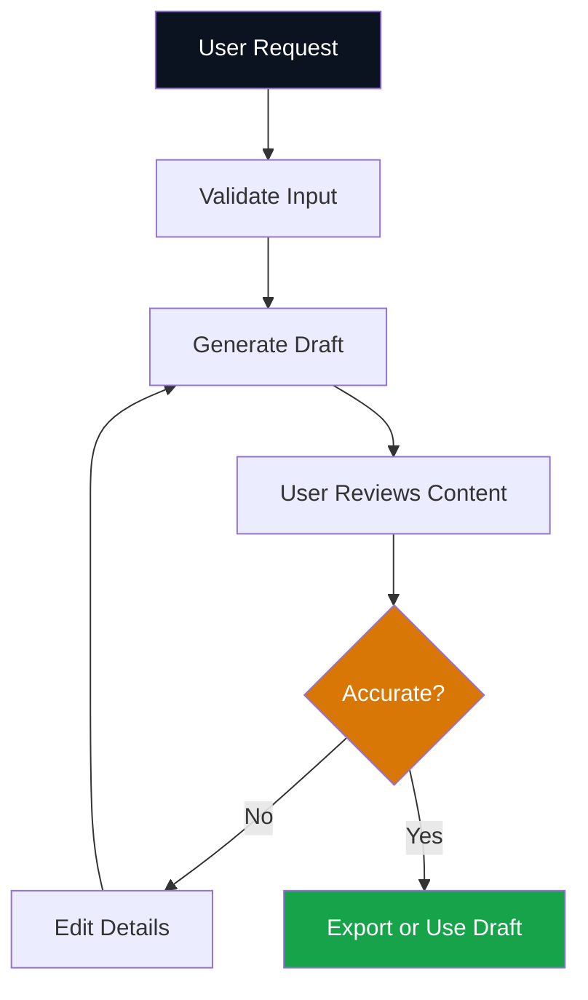
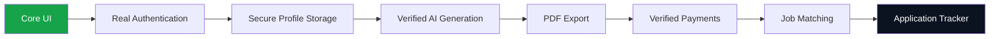
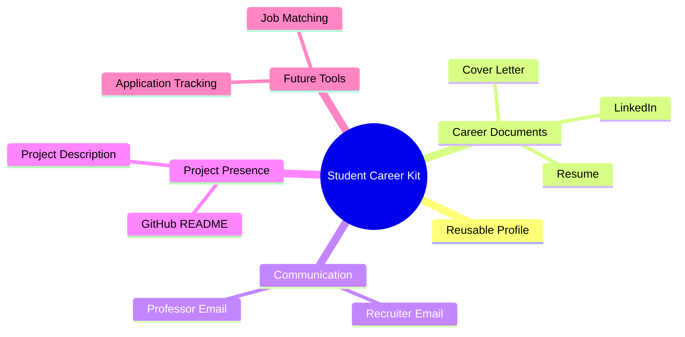

<div align="center">

# 🎓 Student Career Kit

### Create once. Apply everywhere.

**One profile. Six career tools. Smarter applications.**

<p>
  
</p>

[](https://nextjs.org/)
[](https://www.typescriptlang.org/)
[](https://tailwindcss.com/)
[](https://github.com/mahik2007/Student-career-kit)

[🌐 Live Demo](https://mahik2007.github.io/Student-career-kit/) · [💻 Repository](https://github.com/mahik2007/Student-career-kit) · [👩‍💻 Developer](https://github.com/mahik2007)

</div>

---

## 📌 01. Overview

**Student Career Kit** is a career-preparation platform for students and freshers. Create a career profile once and use it to prepare professional application materials.

| 🎯 Target users | 🛠️ Core tools | 💳 Planned pricing |
|---|---|---|
| Students & freshers | 6 generators | ₹79 / ₹199 one-time |

---

## 🔄 02. How It Works



---

## 🧰 03. Product Features

<table>
<tr>
<td width="50%">

### 📄 Resume Builder
- ATS-friendly structure
- Education and skills
- Projects and achievements

</td>
<td width="50%">

### ✉️ Cover Letter
- Role-focused drafts
- Professional structure
- Editable content

</td>
</tr>
<tr>
<td>

### 💼 LinkedIn Content
- About section
- Headlines
- Professional posts

</td>
<td>

### 📬 Outreach Email
- Recruiter emails
- Professor outreach
- Internship enquiries

</td>
</tr>
<tr>
<td>

### 🚀 Project Writer
- Clear project summaries
- Features and tech stack
- Resume-ready descriptions

</td>
<td>

### 🐙 GitHub README
- Project documentation
- Markdown structure
- Setup and feature sections

</td>
</tr>
</table>

---

## 🗺️ 04. Platform Architecture



---

## 📊 05. Product at a Glance



> The chart represents the six planned core generator categories, not usage analytics or performance data.

---

## 🧑‍🎓 06. Career Profile



A reusable profile helps keep application materials consistent while allowing each document to be edited for its purpose.

---

## 🛡️ 07. Accuracy First

Student Career Kit should:

- ✅ Use user-provided qualifications and experience.
- ✅ Keep generated content editable.
- ✅ Avoid invented skills, achievements, and metrics.
- ✅ Encourage users to verify every application before sending.

---

## 💻 08. Technology Stack

| Technology | Purpose |
|---|---|
| Next.js | Web framework |
| React | UI components |
| TypeScript | Type-safe development |
| Tailwind CSS | Styling |
| Supabase | Planned authentication and database integration |
| AI API | Planned content-generation integration |
| Razorpay | Planned payment integration |
| PDF generation | Document export capability to verify |

---

## 🔐 09. Application Flow & Security



**Production requirements**

- Server-side authentication and authorization
- Secure storage of API keys
- Server-verified payment status
- Server-side admin access checks
- Privacy-aware handling of career data

---

## 💳 10. Pricing Model

| Plan | Planned price | Intended offering |
|---|---:|---|
| Essential | ₹79 one-time | Core career generators |
| Complete Suite | ₹199 one-time | Advanced tailoring and career workspace |

<sub>Pricing and premium features are proposed and should not be considered available until confirmed in the live application.</sub>

---

## 📈 11. Roadmap



| Feature | Status |
|---|---|
| Core interface | In development |
| Real authentication | To verify |
| Persistent database | To verify |
| AI integrations | To verify |
| Payment verification | To verify |
| Job matching | Planned / to verify |
| Application tracker | Planned |

---

## ⚙️ 12. Run Locally

### Prerequisites
- Node.js
- npm
- Git

### Installation

```bash
git clone https://github.com/mahik2007/Student-career-kit.git
cd Student-career-kit
npm install
npm run dev
```

Open `http://localhost:3000`.

### Available commands

```bash
npm run dev
npm run build
npm run start
npm run lint
```

<sub>Run only the scripts defined in the project's package.json.</sub>

---

## 📁 13. Project Structure

```text
Student-career-kit/
├── public/
├── src/
│   └── app/
├── package.json
├── tsconfig.json
├── next.config.*
├── tailwind.config.*
└── README.md
```

<sub>Illustrative structure; verify exact filenames and directories in the current repository.</sub>

---

## 🎨 14. Design System

| Element | Value |
|---|---|
| Primary background | `#0B1220` |
| Accent green | `#16A34A` |
| Hover green | `#15803D` |
| Light background | `#F8F9FF` |
| Font | Plus Jakarta Sans |

**Design goals:** clear navigation · readable documents · responsive layouts · focused workflows.

---

## 🌟 15. What Makes It Useful?



- One profile for multiple career materials
- Student-focused workflows
- Editable drafts
- Emphasis on truthful representation

---

## 🧭 16. Product Principle

> **Create once. Apply everywhere.**
>
> Spend less time formatting repetitive career documents and more time improving the work they represent.

---

## 👩‍💻 17. Author

**Mahima Kumari**  
BS–MS Artificial Intelligence & Cybersecurity student at IIT Patna

- GitHub: [@mahik2007](https://github.com/mahik2007)
- Portfolio: [mahima-portfolio](https://mahik2007.github.io/mahima-portfolio/)

---

<div align="center">

### 🎓 Student Career Kit

**Your career profile. Your story. Your next opportunity.**

[⭐ Star the Repository](https://github.com/mahik2007/Student-career-kit)

<sub>Built for students and freshers · Features and integrations may change during development.</sub>

</div>

